

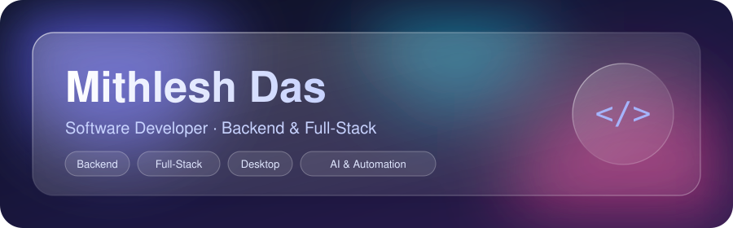

 

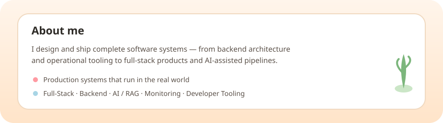

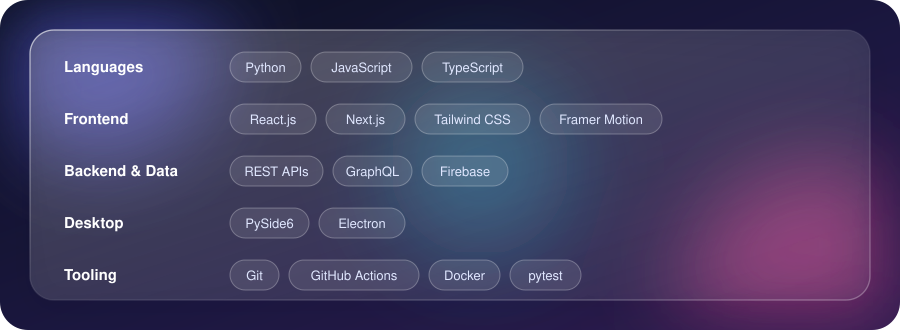

<h2>Featured projects</h2>

<a href="https://github.com/livelyfun/Release-Guardian">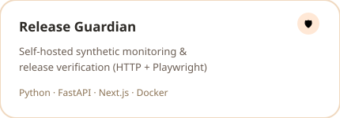</a>
<a href="https://github.com/livelyfun/Stockpilot">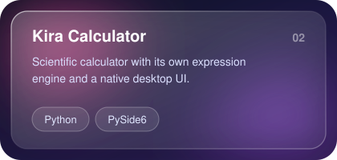</a>
<a href="https://github.com/livelyfun/Melbourne-Property-Management-and-Services-Australia">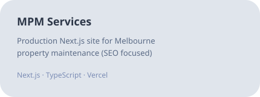</a>
<a href="https://github.com/livelyfun/stock-management-system">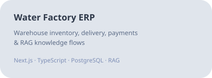</a>
<a href="https://github.com/livelyfun/AI-Reel-Studio">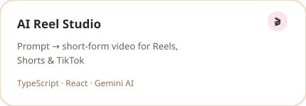</a>
<a href="https://github.com/livelyfun/Track-the-stock-market">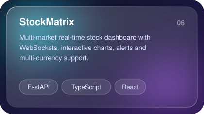</a>

<h2>GitHub stats</h2>

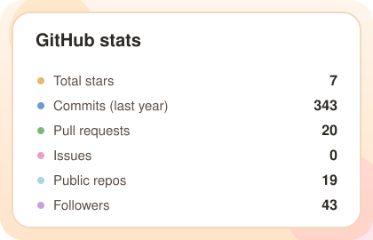
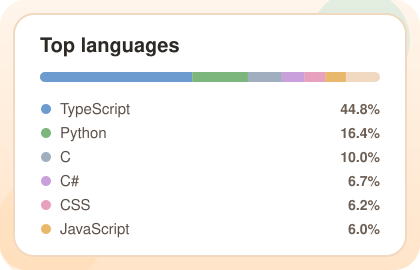

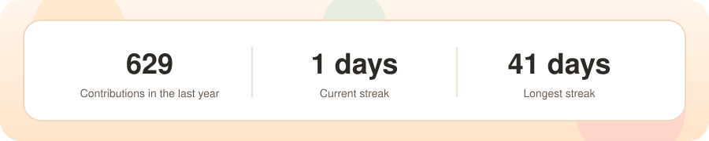

<h2>Trophies</h2>

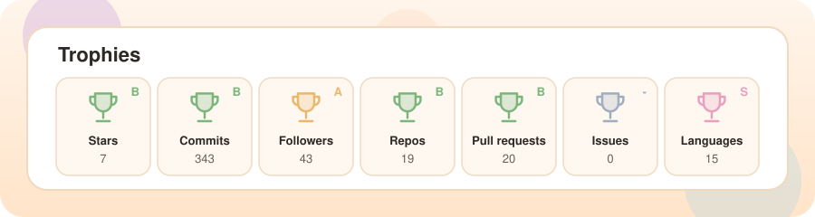

<h2>Contribution snake</h2>


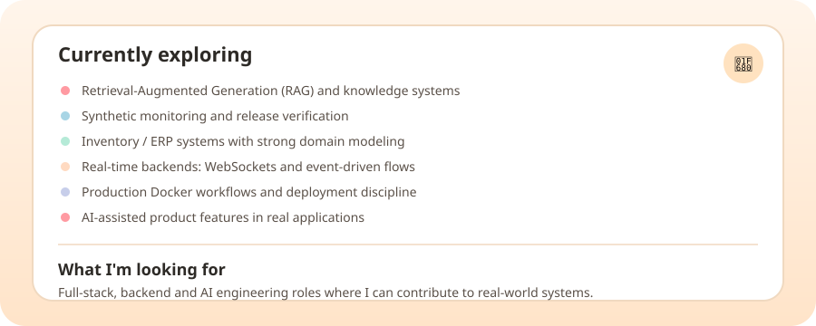

<!-- AUTO:START -->

## 📊 GitHub Snapshot

  
  
  
  

## 🚀 Recent Projects

<table>
<tr>
<td width="50%" valign="top">

### [AI-Reel-Studio](https://github.com/livelyfun/AI-Reel-Studio)

An end-to-end AI platform to automatically generate, edit, and export viral short-form videos for Instagram Reels, YouTube Shorts, and TikTok.

**C** · ⭐ 1 · 🍴 0

Updated 2 days ago

</td>
<td width="50%" valign="top">

### [Prism-Files-A-Premium-Android-File-Manager](https://github.com/livelyfun/Prism-Files-A-Premium-Android-File-Manager)

Prism Files is a modern Android file manager crafted with a harmonious fusion of Skeuomorphism, Neumorphism, and Glassmorphism, powered by an AES-256-GCM Hardware-Backed Encrypted Vault.

**Kotlin** · ⭐ 0 · 🍴 0

Updated 3 days ago

</td>
</tr>
<tr>
<td width="50%" valign="top">

### [mithi](https://github.com/livelyfun/mithi)

practicing git as a begginer 

**JavaScript** · ⭐ 1 · 🍴 0

Updated 3 days ago

</td>
<td width="50%" valign="top">

### [kira-calculator](https://github.com/livelyfun/kira-calculator)

A secure, cross-platform desktop calculator built with Python and PySide6, featuring standard, scientific, programmer, and unit-converter modes with native Linux, Windows, and macOS builds.

**Python** · ⭐ 1 · 🍴 0

Updated 3 days ago

</td>
</tr>
<tr>
<td width="50%" valign="top">

### [Rishika-Timashina](https://github.com/livelyfun/Rishika-Timashina)

Digital Marketing Strategist

**TypeScript** · ⭐ 0 · 🍴 0

Updated 8 days ago

</td>
<td width="50%" valign="top">

### [Release-Guardian](https://github.com/livelyfun/Release-Guardian)

Self-hosted synthetic monitoring and release verification: HTTP, Playwright, and Lighthouse checks, regression detection, deployment correlation, and incident tracking. Multi-tenant, AGPL-3.0, pre-1.0.

**Python** · ⭐ 0 · 🍴 0

Updated 8 days ago

</td>
</tr>
</table>

## 💻 Most Used Languages

**TypeScript** · 45.2% &nbsp; **Python** · 16.5% &nbsp; **C** · 10.0% &nbsp; **C#** · 6.7% &nbsp; **CSS** · 6.2% &nbsp; **JavaScript** · 6.0% &nbsp; **Kotlin** · 4.8% &nbsp; **HTML** · 4.6%

## 🔥 Recent Public Activity

- [livelyfun/livelyfun](https://github.com/livelyfun/livelyfun) — 1 commit · yesterday
- [livelyfun/livelyfun](https://github.com/livelyfun/livelyfun) — 1 commit · yesterday
- [livelyfun/livelyfun](https://github.com/livelyfun/livelyfun) — 1 commit · yesterday
- [livelyfun/livelyfun](https://github.com/livelyfun/livelyfun) — 1 commit · yesterday
- [livelyfun/livelyfun](https://github.com/livelyfun/livelyfun) — 1 commit · yesterday

🤖 Generated from public GitHub data. Last sync: 13 Nov 2026, 03:17 (Asia/Kathmandu).

<!-- AUTO:END -->

